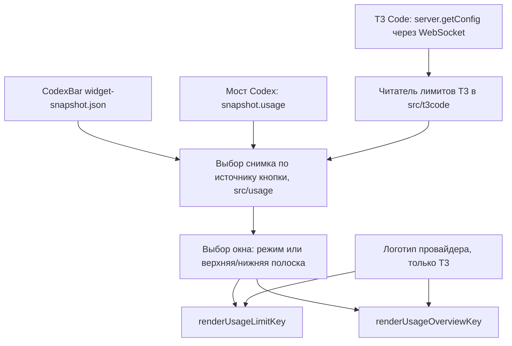

# Источники лимитов и галочки источников задач - Plan

## Goal Capsule

- **Objective:** владелец стримдека видит на кнопках лимитов остаток по выбранному провайдеру (Codex, Claude или OpenCode) и выбранному окну, в том числе на Mac без CodexBar. Кнопки агентов показывают задачи из любого сочетания Codex, OpenCode и T3 Code.
- **Means:** выбор источника и окон в настройках существующих кнопок «Usage Limit» и «Usage Overview» с чтением лимитов из T3 Code через его локальный WebSocket (KTD1, KTD2), а также три галочки вместо списка «Task source» (KTD7).
- **Authority:** явные решения пользователя (Key Decisions) > `AGENTS.md` и `CONTRIBUTING.md` > этот план > умолчания навыков.
- **Execution profile:** один набор локальных коммитов в `main`, по коммиту на каждый пункт U1–U7. Ветки, push, pull request и публикация релиза в рамки не входят.
- **Stop conditions:** остановиться и вернуть вопрос владельцу, если сервер T3 отвергает чтение лимитов с правом `orchestration:read` или если изменение затрагивает дисплей задач или кнопку жетонов сброса за пределами R14–R16.
- **Finish and ship:** исполнитель `ce-work` доводит до локальных коммитов и приёмки. Публикация и проверка на физическом стримдеке остаются за владельцем.

---

## Product Contract

### Summary

Обе кнопки лимитов получают список «Источник» и выбор окон, а у кнопки с полосками появляется своя страница настроек. Для Codex на Mac при отсутствии свежего CodexBar возвращается чтение лимитов из запущенного приложения Codex. Источники T3 читают лимиты Codex, Claude и OpenCode из локального T3 Code и отмечаются логотипом провайдера. Список «Task source» на кнопках агентов заменяется тремя галочками.

### Problem Frame

Сейчас кнопки лимитов показывают только Codex. На macOS данные берутся исключительно из CodexBar: функция `composeMacUsage` в `src/usage/usage.ts` при его отсутствии возвращает пустой список окон, и человек с одним приложением Codex видит «—». Плагин публичный, поэтому это касается всех таких пользователей. У владельца есть подписки Claude и OpenCode Go, лимиты которых T3 Code уже собирает и показывает на своей странице, но стримдек их не видит. Наконец, источник задач выбирается одним из четырёх жёстких вариантов, и сочетание вроде «Codex + T3 Code без OpenCode» недоступно.

### Key Decisions

- **Источник выбирается списком на каждой кнопке.** Пункты: Codex · автоматически, Codex · CodexBar, Codex · приложение, T3 · Codex, T3 · Claude, T3 · OpenCode. Governs R1, R2, R3. (session-settled: user-directed — chosen over только CodexBar на macOS: у людей без CodexBar кнопки пусты, а у пользователей T3 данные уже есть в T3)
- **Окно на кольце выбирается для каждого провайдера, пятичасовое окно остаётся у всех.** Governs R5, R6. (session-settled: user-directed — chosen over фиксированного набора окон: у разных подписок разные окна, а плагин публичный)
- **На полосках две полоски, каждую выбирает пользователь.** Governs R7. (session-settled: user-directed — chosen over фиксированных `5H`/`WK` и трёх полосок: отрисовка заготовки не меняется)
- **Отрисовка кнопок остаётся прежней.** Governs R8. (session-settled: user-directed — chosen over новой отрисовки: существующие заготовки «прекрасно работают»)
- **Логотип провайдера ставится в угол только у источников T3.** Governs R11, R12. (session-settled: user-directed — chosen over буквенных меток и логотипа на всех источниках; правило в `AGENTS.md` изменено коммитом `376758b`)
- **Старые нынешние кнопки продолжают работать как раньше.** Governs R4. (session-settled: user-approved — chosen over переключения старых кнопок на T3: старые профили не ломаются)
- **Источники задач выбираются галочками.** Governs R14, R15, R16. (session-settled: user-approved — chosen over списка из четырёх вариантов: разрешает любые сочетания)

### Requirements

**Источники лимитов**

- R1. «Codex · автоматически» показывает данные CodexBar, если они свежие (не старше пяти минут), иначе данные запущенного приложения Codex, иначе «—».
- R2. «Codex · CodexBar» и «Codex · приложение» показывают только свой источник, а при его отсутствии «—».
- R3. Пункты T3 читают лимиты из локального T3 Code на macOS тем же сохранённым подключением только на чтение, что использует источник задач T3, и показывают «—», если T3 не запущен, не подключён или не отдаёт нужное окно.
- R4. Кнопки без сохранённой настройки источника работают как «Codex · автоматически», а их нынешняя настройка режима окна сохраняет смысл.

**Окна**

- R5. На «Usage Limit» список окон зависит от источника: для Codex — Автоматически, 5 часов, Неделя; для Claude — ещё «Неделя · Fable»; для OpenCode — ещё «Месяц».
- R6. «Автоматически» показывает 5 часов, а если такого окна нет, неделю, как сейчас.
- R7. На «Usage Overview» пользователь выбирает окно верхней и нижней полоски из окон источника, по умолчанию `5H` и `WK`.
- R8. Кольцо, полоски, цвета, проценты использованного и подписи остаются прежними, новые только подписи `FBL` и `MO`.
- R9. Отсутствующее на подписке окно отображается как «—», а не как ноль.

**Поведение и границы**

- R10. Кнопки лимитов только показывают данные, нажатие ничего не делает, жетоны сброса не расходуются.
- R11. В углу кнопки с источником T3 стоит логотип провайдера, у источников Codex логотипа нет.
- R12. Логотип берётся из источника с явными условиями повторного использования, не изменяется по форме и перечислен в `README.md` с пометкой о товарных знаках. Если условия для провайдера запрещают такое использование, его кнопка остаётся без логотипа.
- R13. На Windows пункты T3 недоступны, а поведение кнопок лимитов там прежнее.

**Источники задач**

- R14. На кнопках агентов источники задач выбираются тремя галочками: Codex, OpenCode, T3 Code. Последнюю отмеченную снять нельзя.
- R15. Старые значения `taskSource` переносятся: одиночный источник — одна галочка, `All` и `Both` — все три.
- R16. Активная очередь принудительно включена, если отмечен хоть один источник кроме Codex. Галочки OpenCode и T3 Code на Windows неактивны.

### Acceptance Examples

- AE1. **Covers R1.** Дано: CodexBar не установлен, Codex запущен и отдаёт лимиты. Когда кнопка в режиме «Codex · автоматически», тогда она показывает лимиты приложения.
- AE2. **Covers R1.** Дано: снимок CodexBar старше пяти минут, Codex закрыт. Тогда кнопка показывает «—».
- AE3. **Covers R5, R9.** Дано: источник «T3 · Claude», окно «5 часов», а T3 не отдаёт окно `five_hour`. Тогда кольцо показывает «—» с подписью `5H`.
- AE4. **Covers R15, R16.** Дано: старая настройка `taskSource: "All"`. Тогда отмечены три галочки и активная очередь принудительно включена.

### Scope Boundaries

- Лимиты T3 с удалённых машин по SSH не читаются, только локальный T3 на Mac.
- Кнопка «Reset Credits (Read Only)» не меняется и по-прежнему показывает жетоны Codex.
- Дисплей задач, порядок очереди и кольцо контекста не меняются.
- Рассмотрено и не строится: постоянная подписка на поток конфигурации T3 (`subscribeServerConfig`). Однократный запрос раз в минуту проще, а данные T3 и так обновляются примерно с этой частотой. Пересмотреть, если замеры покажут заметную нагрузку от ответа около 1 МиБ.

#### Deferred to Follow-Up Work

- Пункты окон, которые появятся у новых подписок или моделей помимо «Неделя · Fable» и «Месяц».

---

## Planning Contract

### Key Technical Decisions

- KTD1. **Лимиты T3 читаются однократным вызовом `server.getConfig` через WebSocket.** Порядок: `POST /api/auth/websocket-ticket` с сохранённым токеном, затем `ws://<loopback>/ws?orchestrationProtocol=2&wsTicket=…`, затем запрос `{"_tag":"Request","tag":"server.getConfig","payload":{}}`, затем ответ `Exit` с `providers[].usageLimits`. Это проверено на живом сервере `0.1.10-nightly.20261111.4544`. HTTP-адреса для конфигурации нет, а методу хватает уже выданного права `orchestration:read` (в коде сервера `serverGetConfig` сопоставлен с `AuthOrchestrationReadScope`). Новых прав и повторной привязки не требуется.
- KTD2. **Читатель лимитов T3 живёт в `src/t3code` и переиспользует проверку подключения источника задач.** Используются защищённое чтение `t3code.json`, проверка `server-runtime.json`, живость процесса и только loopback-адрес (`localRuntime`, `readPrivateConfig`, `loopbackOrigin` в `src/t3code/source.ts`). Наружу через `#t3code` отдаются нормализованные снимки по провайдерам, контроллер их только потребляет. Так сохраняются границы из `docs/ARCHITECTURE.md`: источники не импортируют друг друга, `#usage` не делает ввод-вывод.
- KTD3. **Опрос T3 раз в 60 секунд на существующем таймере контроллера и только при спросе.** Спрос есть, пока хоть одна кнопка лимитов выбрала источник T3. Новый запрос не стартует, пока не завершён предыдущий. Тайм-аут запроса 5 секунд, ответ больше 8 МиБ отвергается (живой ответ около 1 МиБ). Второй таймер не заводится, по образцу `quotaInFlight` в `src/stream-deck/controller.ts`.
- KTD4. **Окна сопоставляются по идентификаторам T3 и длительности.** Окно с `kind` `session` и 300 минутами становится «5 часов», `weekly` с 10080 минутами — «Неделя». У Claude окно `seven_day_fable` становится «Неделя · Fable» (`FBL`), у OpenCode `go_monthly` (`kind` `monthly`) — «Месяц» (`MO`). Дополнительное недельное окно не должно затенять основное: «Неделя» берёт окно без модельного суффикса. Живые идентификаторы: Codex `primary`/`secondary`, Claude `five_hour`/`seven_day`/`seven_day_fable`, OpenCode `go_rolling`/`go_weekly`/`go_monthly`.
- KTD5. **Режим и вид окна расширяются значениями, старые сохраняют смысл.** `UsageLimitMode` и `UsageWindowKind` в `src/agents/types.ts` получают `weekly-fable` и `monthly`, нормализация по KTD4 присваивает окнам эти виды, а «Неделя» выбирает только вид `weekly`. Новые поля настроек кнопки: `source`, `mode` (как сейчас), `topWindow`, `bottomWindow`. Неизвестные значения разбираются в умолчания. Режим, недоступный выбранному источнику, разбирается как «Автоматически». Это реализует R4.
- KTD6. **«Codex · приложение» на macOS берёт уже собираемые мостом данные.** Источник — `snapshot.usage` из `src/codex/bridge.ts`, запрос `rate-limit-status`. Новый путь к приложению не нужен: меняется только `composeMacUsage`/`selectAccountUsage` в `src/usage/usage.ts` и формулировка в `docs/ARCHITECTURE.md`, где сейчас сказано, что на macOS к данным приложения плагин не возвращается. Существующий тест «macOS never falls back to renderer quota windows» намеренно меняется под R1.
- KTD7. **Источники задач хранятся новым массивом в общих настройках, старое поле читается и дописывается для отката.** Новое поле — `taskSources`. Чтение: сначала новый массив, иначе разбор `taskSource` по R15. Запись: оба поля, где в `taskSource` пишется ближайшее старое значение (один источник — он сам, иначе `All`). Это нужно, чтобы откат на старую версию плагина не ломал кнопки. Внутренний тип `TaskSource` превращается в набор, а `selectTaskCandidates`, `usesActiveQueue`, `shouldCollectOpenCode` и спрос T3 (`syncDemand`) принимают набор.
- KTD8. **Приёмка этапа — тонкий скрипт поверх существующих проверок, запускаемый в изолированной копии.** Того требует блок Compound Engineering в `AGENTS.md`. Живой плагин связан ссылкой с `dist/com.xonika9.codex-deck.sdPlugin`, а сборка очищает этот каталог вместе с журналами, поэтому запуск в рабочем каталоге запрещён (`AGENTS.md`, раздел «Setup and validation»).

### High-Level Technical Design

Поток данных лимитов:

Правило источника Codex · автоматически: свежий CodexBar, если нет — данные моста, если нет и их — пустой снимок со здоровьем `offline` или `degraded`. Жетоны сброса накладываются из моста как сейчас.

### Assumptions

- Формат ответа `server.getConfig` и ВебСокет-протокол T3 Code не являются публичным контрактом и могут измениться в ночных сборках. Проверенная версия записывается в `docs/T3CODE_COMPATIBILITY.md`, а при несовпадении формата кнопка показывает «—», а не ошибочные числа.

### Risks & Dependencies

| Риск | Смягчение |
|---|---|
| Изменение протокола или формы ответа T3 | Строгая проверка полей в разборе, «—» и одно сообщение в журнал при переходе в отказ (по образцу `reportedFailures` в `src/t3code/source.ts`) |
| Условия использования логотипа окажутся запретительными | R12: кнопка без логотипа, исполнитель записывает источник и условия в отчёт |
| Ответ около 1 МиБ раз в минуту | Ограничение размера и тайм-аут по KTD3, опрос только при спросе |
| Изменение поведения macOS для старых кнопок без CodexBar | Это и есть цель R1; при наличии CodexBar поведение не меняется (AE1, AE2) |

---

## Implementation Units

### U1. Скрипт приёмки этапа

- **Goal:** одна команда приёмки, которая прогоняет существующие проверки в изолированной копии и пишет машиночитаемый результат.
- **Requirements:** KTD8.
- **Dependencies:** нет.
- **Files:** `scripts/stage-acceptance.mjs`, `package.json` (скрипт `acceptance`), `test/stage-acceptance.test.ts`, `CONTRIBUTING.md` (одна строка о команде).
- **Approach:**
  1. Отказ, если `git status --porcelain` не пуст. Записывается `HEAD`.
  2. Экспорт отслеживаемого дерева `HEAD` во временный каталог без ссылок на рабочий `dist`, затем `npm ci`, `npm run lint`, `npm run check:boundaries`, `npm run check`, `npm test`, `npm run validate`, `npm run pack`, `npm run audit:release` в этой копии.
  3. После прогона проверка, что `HEAD` и состояние рабочего дерева не изменились.
  4. Запись JSON с ревизией, временем, строкой на каждую проверку (`blocking`, статус, код выхода, длительность) и итогом в путь из аргумента или во временный каталог. Путь печатается.
- **Patterns to follow:** вынос логики в импортируемый модуль, как `scripts/finalize-release.mjs` (`TESTING.md`, раздел «Scripts»).
- **Test scenarios:**
  - Грязное дерево во временном git-репозитории — отказ до запуска проверок, в JSON итог `rejected` с причиной.
  - Чистое дерево и проверки-заглушки, все успешны — итог `pass`, по строке на каждую проверку.
  - Одна заглушка падает — итог `fail`, остальные строки сохранены.
  - Изменение `HEAD` во время прогона — итог `rejected`.
- **Verification:** тесты проходят, команда на чистом дереве этого репозитория пишет JSON. Сам полный прогон выполняется на этапе приёмки, а не в этом пункте.

### U2. Модель источников и окон лимитов

- **Goal:** чистые функции разбора настроек кнопки, выбора снимка по источнику и выбора окна, включая запасной путь Codex на macOS.
- **Requirements:** R1, R2, R4, R5, R6, R7, R9, R13; KTD4, KTD5, KTD6.
- **Dependencies:** нет.
- **Files:** `src/agents/types.ts`, `src/usage/usage.ts`, `test/usage.test.ts`.
- **Approach:**
  1. Тип источника лимитов и расширенный `UsageLimitMode` (KTD5). Подписи `FBL` и `MO` добавляются в `usageLabel`.
  2. Разбор настроек `source`, `mode`, `topWindow`, `bottomWindow` с умолчаниями по R4 и R7.
  3. `composeMacUsage`/`selectAccountUsage` различают три варианта источника Codex (KTD6). На Windows любой источник, включая сохранённый на Mac источник T3, разбирается как «Codex · автоматически» и возвращает прежний результат (R13).
  4. Выбор окна по режиму и по полоске с учётом KTD4, отсутствие окна по R9.
- **Patterns to follow:** существующие `selectUsageWindow`, `parseUsageLimitMode`, `composeMacUsage`.
- **Test scenarios:**
  - Covers AE1. macOS, CodexBar отсутствует, мост отдаёт окна — «автоматически» возвращает окна моста со здоровьем `ready`.
  - Covers AE2. macOS, снимок CodexBar отсутствует (устаревший отсеивается раньше), моста нет — пустые окна, здоровье не `ready`.
  - macOS, CodexBar свежий и мост с окнами — «автоматически» берёт CodexBar, жетоны из моста.
  - «Codex · CodexBar» при работающем мосте и без CodexBar — пусто.
  - «Codex · приложение» при свежем CodexBar — окна моста.
  - Windows — результат совпадает с нынешним для любого источника Codex.
  - Windows, настройки с источником «T3 · Claude» — результат совпадает с «Codex · автоматически».
  - Настройки `{}` — источник «Codex · автоматически», режим «Автоматически», полоски `5H`/`WK`.
  - Настройки `{ mode: "weekly" }` из старого профиля — неделя.
  - Источник «T3 · Codex» с режимом `weekly-fable` — разбирается как «Автоматически».
  - Окна Claude с `seven_day` и `seven_day_fable` — «Неделя» выбирает `seven_day`, «Неделя · Fable» выбирает `seven_day_fable`.
  - Режим «5 часов» при отсутствии такого окна — пустой результат, а не неделя.
- **Verification:** тесты `test/usage.test.ts` проходят, включая изменённый тест о macOS.

### U3. Читатель лимитов T3

- **Goal:** по запросу контроллера получить из локального T3 нормализованные снимки лимитов Codex, Claude и OpenCode со здоровьем.
- **Requirements:** R3, R9, R10, R13; KTD1, KTD2, KTD3, KTD4.
- **Dependencies:** U2 (типы окон).
- **Files:** `src/t3code/usage.ts` (новый), `src/t3code/source.ts` (вынос общей проверки подключения без изменения поведения), `src/t3code/index.ts`, `test/t3code-usage.test.ts`, `test/support/` (образец ответа).
- **Approach:**
  1. Общая проверка локального подключения выносится из `T3CodeSource` в функцию модуля, источник задач продолжает ею пользоваться.
  2. Последовательность из KTD1 через библиотеку `ws`, которая уже в зависимостях. Ограничения из KTD3. Запрос билета идёт только на проверенный loopback-адрес с `redirect: "error"`, как `localShell`. Билет передаётся только в адресе WebSocket, новый билет на каждый опрос, соединение закрывается сразу после ответа `Exit`. Токен, билет, адрес с параметрами и тело ответа не пишутся в журнал и не сохраняются.
  3. Разбор `providers[]` для `codex`, `claudeAgent`, `opencode`: окна, `checkedAt` и признак `unavailable`. Окна нормализуются в `UsageWindow` по KTD4 (`usedPercent`, `remainingPercent = 100 − used`, `resetsAt`, длительность).
  4. Здоровье: `ready` при успешном ответе. `offline` при отсутствии конфигурации, процесса или отказе учётных данных. `degraded` при тайм-ауте или неверном ответе с сохранением последнего хорошего снимка не дольше 5 минут. Переходы пишутся в журнал по разу без токена и адресов.
  5. Образец ответа для тестов собирается по белому списку: только `providers[].driver`, `instanceId` и `usageLimits` трёх провайдеров. Почта, пути, идентификаторы окружения, ключи, токены и любые другие поля живого ответа в образец не попадают.
- **Patterns to follow:** `localRuntime`, `localShell` и `reportedFailures` в `src/t3code/source.ts`; локальный сервер в `test/t3code-source.test.ts`.
- **Test scenarios:**
  - Локальный тестовый HTTP+WS сервер отдаёт билет и образец — три снимка с ожидаемыми окнами и подписями (литералы в тесте).
  - Билет отвергнут кодом 401 — здоровье `offline`, снимков нет, токен не попадает в журнал.
  - Сервер не отвечает дольше тайм-аута — `degraded`, предыдущий снимок сохранён.
  - Ответ больше лимита — отказ без разбора.
  - Ответ `Exit` с ошибкой — `degraded`.
  - Нелоопбэк `origin` в конфигурации — отказ без сетевого запроса.
  - Запрос билета получает ответ 302 на другой адрес — переадресация не выполняется, здоровье `degraded`, журнал не содержит токена, билета и адреса.
  - Повторный вызов во время незавершённого — второй запрос не уходит.
  - Провайдер с `unavailable` — снимок без окон.
- **Verification:** тесты проходят на macOS и пропускаются на Windows с указанием причины. Тесты `test/t3code-source.test.ts` проходят без изменений.

### U4. Подключение к кнопкам и страницы настроек

- **Goal:** кнопки лимитов отображают выбранный источник и окна, а настройки меняются из Stream Deck.
- **Requirements:** R1–R10, R13; KTD3, KTD5.
- **Dependencies:** U2, U3.
- **Files:** `src/stream-deck/actions.ts`, `src/stream-deck/controller.ts`, `src/stream-deck/render.ts` (подписи и выбранная пара окон для полосок), `src/plugin.ts`, `static/property-inspector/usage-limit.html`, `static/property-inspector/usage-overview.html` (новый), `static/manifest.json` (`PropertyInspectorPath` и подсказки двух действий), `test/controller.test.ts`, `test/usage-settings.test.ts` (новый, по образцу `test/agent-settings.test.ts`).
- **Approach:**
  1. Регистрации кнопок хранят разобранные настройки целиком. `UsageOverview` получает `onDidReceiveSettings`.
  2. Контроллер выбирает снимок по источнику кнопки и запускает опрос T3 только при спросе (KTD3).
  3. `renderUsageOverviewKey` принимает два выбранных окна с их подписями вместо фиксированных `5H`/`WK`, оформление полосок не меняется.
  4. На страницах настроек список окон перестраивается при смене источника. Если сохранённое окно не предлагается новым источником, страница показывает и сохраняет «Автоматически» (для полосок — `5H`/`WK`), чтобы страница и кнопка не расходились (KTD5). Пункты T3 скрыты при Windows (данные о платформе берутся из информации, которую Stream Deck передаёт странице настроек).
  5. Подсказки в манифесте перестают упоминать только Codex.
  6. При здоровье T3 `degraded` кнопка рисует сохранённые окна с существующим цветом предупреждения, при `offline` — «—».
- **Patterns to follow:** `UsageLimit`/`registerUsageLimit`/`updateUsageLimitMode`, страница `usage-limit.html`.
- **Test scenarios:**
  - Кнопка «Usage Limit» с источником «T3 · OpenCode» и окном «Месяц», заглушка T3 отдаёт `go_monthly` 9% — изображение содержит `data-usage-used="9"` и подпись `MO`.
  - «Usage Overview» с верхней «Неделя · Fable» и нижней «5 часов» для Claude — две полоски в этом порядке с подписями `FBL` и `5H`.
  - Смена настроек кнопки без перерегистрации — следующее изображение отражает новый источник.
  - Нет кнопок с источником T3 — заглушка T3 не опрашивается. Появилась одна — опрашивается не чаще раза в 60 секунд по управляемым часам.
  - Страница настроек: старые настройки `{ mode: "weekly" }` показывают источник «Codex · автоматически» и окно «Неделя», смена источника на «T3 · Claude» добавляет пункт «Неделя · Fable» и сохраняет `source` в настройках действия.
  - Страница настроек на Windows не предлагает пункты T3.
  - Нажатие любой кнопки лимитов не вызывает команд.
  - Заглушка T3 переходит в `degraded` после удачного ответа — кнопка показывает прежний процент с цветом предупреждения, при `offline` — «—».
  - Страница настроек: источник с сохранённым окном «Неделя · Fable» меняется на «T3 · Codex» — страница показывает и сохраняет «Автоматически».
- **Verification:** тесты контроллера и страниц настроек проходят, `streamdeck validate` принимает манифест в составе приёмки.

### U5. Логотипы провайдеров

- **Goal:** у источников T3 в углу кнопки стоит логотип провайдера, не мешающий подписи и цифрам.
- **Requirements:** R8, R11, R12.
- **Dependencies:** U4.
- **Files:** `src/stream-deck/render.ts`, `src/stream-deck/provider-marks.ts` (новый, контуры SVG и сведения об источнике), `README.md` (раздел о товарных знаках и источниках логотипов), `test/render-theme.test.ts` или `test/usage.test.ts`.
- **Approach:**
  1. До кода проверить действующие условия: правила бренда OpenAI, Anthropic, OpenCode и наличие знаков в Simple Icons с его лицензией. Результат с адресами и датой записать в отчёт пункта.
  2. Разрешённые знаки внедряются как одноцветные контуры без изменения формы в цвете подписи темы. Запрещённые или не найденные не внедряются (R12).
  3. На кольце знак в свободном верхнем углу. На полосках верхняя подпись сдвигается ровно настолько, чтобы знак не перекрывал текст.
- **Patterns to follow:** существующая палитра `SURFACES` и обращение с темами в `src/stream-deck/render.ts`.
- **Test scenarios:**
  - Кольцо с источником «T3 · Claude» — изображение содержит метку знака Claude, с источником «Codex · CodexBar» — не содержит.
  - Полоски с источником T3 — подписи и проценты остаются в изображении, метка знака присутствует.
  - Светлая и тёмная темы — знак использует цвет подписи соответствующей темы.
  - Провайдер без разрешённого знака — изображение без метки знака.
- **Verification:** тесты проходят. В `README.md` перечислены источник и лицензия каждого внедрённого знака и пометка, что товарные знаки принадлежат владельцам и плагин неофициальный. Тест `test/release-docs.test.ts` проходит.

### U6. Документация источников лимитов

- **Goal:** документация описывает новые источники, окна и проверенную версию T3.
- **Requirements:** R1–R13; Assumptions.
- **Dependencies:** U4, U5.
- **Files:** `README.md` (раздел «Usage and reset controls»), `docs/ARCHITECTURE.md` (абзац об учёте использования), `docs/T3CODE_COMPATIBILITY.md` (новый раздел о лимитах: метод, право, проверенная версия, поведение при отказе), `docs/MACOS.md` при наличии упоминаний CodexBar как единственного источника.
- **Approach:** обновить текущие описания, исторические планы не трогать. Иллюстрацию `docs/assets/usage-controls-preview.svg` не перегенерировать без необходимости.
- **Test expectation:** none — документация. Проверяется тестом `test/release-docs.test.ts` и просмотром изменённых ссылок.
- **Verification:** `test/release-docs.test.ts` проходит, ссылки в изменённых файлах ведут на существующие файлы.

### U7. Галочки источников задач

- **Goal:** источники задач для кнопок агентов выбираются любыми сочетаниями.
- **Requirements:** R14, R15, R16; KTD7.
- **Dependencies:** U4 (оба пункта меняют `src/stream-deck/controller.ts` и `test/controller.test.ts`, U7 идёт после U4).
- **Files:** `src/agents/types.ts`, `src/agents/task-source.ts`, `src/stream-deck/controller.ts`, `src/t3code/source.ts` (`syncDemand`), `src/opencode/` (место, где спрос зависит от источника), `static/property-inspector/agent.html`, `README.md`, `docs/ARCHITECTURE.md`, `docs/T3CODE_COMPATIBILITY.md` (упоминания `All`/`Both`), `test/task-source.test.ts`, `test/agent-settings.test.ts`, `test/controller.test.ts`.
- **Approach:**
  1. Набор источников и разбор по KTD7.
  2. Отбор кандидатов, активная очередь, спрос OpenCode и T3, здоровье выбранных источников принимают набор. Логика для «все три» совпадает с нынешним `All`.
  3. Страница настроек: три галочки, последняя отмеченная заблокирована, на Windows галочки OpenCode и T3 неактивны с пояснением. Запись обоих полей.
- **Patterns to follow:** `parseTaskSource`, `selectTaskCandidates`, `selectedTaskHealth`; тесты страницы в `test/agent-settings.test.ts`.
- **Test scenarios:**
  - Covers AE4. `{ taskSource: "All" }` — набор из трёх, активная очередь принудительна.
  - `{ taskSource: "Both" }` — три источника.
  - `{ taskSource: "OpenCode" }` — только OpenCode.
  - `{ taskSources: ["Codex", "T3 Code"] }` — кандидаты Codex и T3 без OpenCode, OpenCode не опрашивается.
  - `{ taskSources: [] }` или мусор — разбирается как только Codex.
  - Только Codex и `activeQueueEnabled: false` — очередь выключена.
  - Страница: снятие последней галочки невозможно. Выбор Codex и T3 сохраняет `taskSources` и `taskSource: "All"`, выбор одного OpenCode сохраняет `taskSource: "OpenCode"`.
  - Страница на Windows — галочки OpenCode и T3 неактивны.
- **Verification:** тесты проходят. Сценарии с «все три» дают те же кандидаты, что и до изменения.

---

## Verification Contract

Приёмка запускается одной командой `npm run acceptance` из U1 на чистом дереве. Скрипт выполняет проверки в изолированной копии и пишет JSON-файл, путь к которому печатает. Результаты приёмки берутся только из этого файла.

| Строка | Тип | Проверка | Свидетельство |
|---|---|---|---|
| Установка и статические проверки | blocking | `npm ci`, `npm run lint`, `npm run check:boundaries`, `npm run check` в копии | Строки `pass` в JSON |
| Автоматические тесты | blocking | `npm test` в копии, включая тесты U1–U5, U7 | Строка `pass` |
| Сборка и манифест | blocking | `npm run validate` в копии | Строка `pass` |
| Пакет и аудит релиза | blocking | `npm run pack`, затем `npm run audit:release` в копии | Строки `pass`, в пакете нет образца ответа T3 с личными данными |
| Живой T3 | hardening | Ручной запуск читателя U3 против живого локального T3 с выводом только чисел окон | Отдельная запись в отчёте, не в JSON |
| Физический стримдек | hardening | Владелец ставит три кнопки на устройство | В отчёте «не проверено», пока владелец не подтвердит |

Сборку, тесты и упаковку нельзя запускать в рабочем каталоге: `dist` связан с установленным плагином (`AGENTS.md`). Отчёт разделяет автоматическую проверку, проверку на живом приложении и проверку на физическом устройстве (`AGENTS.md`).

---

## Definition of Done

| Область | Готово, когда |
|---|---|
| Весь этап | Все строки `blocking` в JSON приёмки — `pass` на чистом дереве итоговой ревизии. Каждый пункт U1–U7 — отдельный коммит, их SHA перечислены в отчёте |
| U1 | Команда приёмки отвергает грязное дерево и пишет JSON |
| U2 | Сценарии выбора источника и окна проходят, Windows без изменений |
| U3 | Читатель возвращает три снимка из образца и корректно деградирует |
| U4 | Обе кнопки отображают выбранные источник и окна, страницы настроек сохраняют поля |
| U5 | Логотипы внедрены только с подтверждёнными условиями, пометка в `README.md` |
| U6 | Документация описывает текущее поведение, `test/release-docs.test.ts` проходит |
| U7 | Галочки работают, старые настройки переносятся, откат на старую версию не ломает кнопки |
| Чистота | В диффе нет кода брошенных попыток, отладочных выводов и личных данных из живого ответа T3 |
